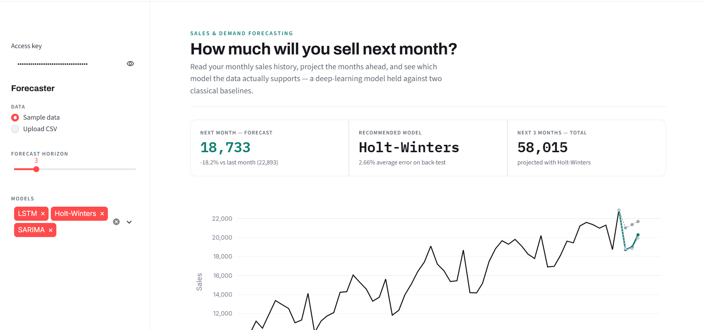

<div align="center">

# 📈 Sales & Demand Forecaster — Explainable Monthly Forecasting

A Streamlit forecasting application for validating monthly sales data, comparing an LSTM with classical time-series baselines, back-testing model accuracy, and producing a practical sales forecast.


</div>

---

## 📌 Project Overview

**Sales & Demand Forecaster** is a Streamlit application that turns monthly sales history into an evaluated, multi-month forecast.

The application validates uploaded CSV data, normalizes it to a monthly time series, trains multiple forecasting approaches, evaluates them on a held-out period, and recommends the model with the lowest measured back-test error.

The project combines a **TensorFlow/Keras LSTM**, **Holt-Winters exponential smoothing**, **SARIMA**, and a transparent **seasonal-naive baseline** in one workflow. It demonstrates that model selection should be based on measured performance rather than assuming that deep learning will always be best. The bundled sample contains 60 synthetic monthly observations from `2020-01` through `2024-12`.

---

## ✨ Features

### 📊 Sales Data Workspace

- 📤 **Sample-data mode** for immediate demonstration
- 📥 **CSV upload mode** with automatic date and sales-column detection
- ✅ **Input validation** for empty, invalid, negative, infinite, and unusable values
- 🗓️ **Monthly aggregation** with sorted dates and missing-month interpolation
- 🚦 **Upload limits** of 20 MB and 10,000 rows
- ⚠️ **User-facing validation messages** for rejected or partially invalid data

### 🧠 AI and Forecasting

- 🤖 **Two-layer LSTM** implemented with TensorFlow/Keras
- 📈 **Holt-Winters** additive trend and seasonal baseline
- 📉 **SARIMA** seasonal statistical baseline
- 🔁 **Seasonal-naive** baseline that repeats the most recent yearly cycle
- 🧪 **Hold-out back-testing** on the most recent 12 months
- 🎯 **MAPE and RMSE evaluation** for model comparison
- 🔁 **Recursive multi-step forecasting** for a 1–12 month horizon
- 🏆 **Automatic model recommendation** based on the lowest valid MAPE
- 🧾 **Graceful model failure isolation** so one failed model does not stop the others

### 🛡️ Reliability and Security Controls

- 🔐 **Fail-closed access-key gate** before loading data or training models
- 🔑 **Environment-variable or Streamlit-secret configuration** through `SALESFORECAST_ACCESS_KEY`
- 🚫 **No hardcoded API keys, passwords, or external AI credentials**
- ⏱️ **Bounded forecast cache** with a five-minute TTL and eight-entry limit
- 🧼 **Escaped dynamic model labels** before HTML rendering
- 🧱 **Generated model artifacts excluded from future Git commits** through `.gitignore`
- 🧪 **Automated authorization, data, metrics, and model tests**

### 🖥️ Streamlit Interface

- 📋 Sidebar controls for data source, forecast horizon, and model selection
- 📈 Interactive historical and forecast chart
- 🏅 Recommended-model readout with expected next-month sales
- 📑 Accuracy table with MAPE and RMSE
- 🧮 Expandable table of forecast values
- 💬 Clear notices for unavailable TensorFlow or failed model runs

---

## 🖼️ Screenshots

| Streamlit|
| --- |
|  |

---

## 🧰 Tech Stack

### Application

- Python 3.12 recommended by `runtime.txt`
- Streamlit
- Pandas and NumPy
- Plotly

### AI and Forecasting

- TensorFlow/Keras
- scikit-learn `MinMaxScaler`
- statsmodels `ExponentialSmoothing`
- statsmodels `SARIMAX`
- MAPE and RMSE evaluation utilities

### Quality Assurance

- pytest
- Python AST compilation checks
- Deterministic TensorFlow seed configuration
- GitHub Actions CI
- Jupyter analysis notebook

### Local Artifacts

- `models/metrics.json` stores the latest training comparison
- `models/lstm.keras` stores the generated LSTM model
- `models/scaler.joblib` stores the generated scaler

Generated model files are reproducible outputs of `train.py` and should not be treated as source code.

---

## 📁 Folder Structure

```text
sales-forecaster/
├── .github/workflows/ci.yml
├── app.py                         # Streamlit application
├── train.py                       # Training and back-testing pipeline
├── requirements.txt               # Pinned runtime dependencies
├── requirements-dev.txt           # Pinned development and LSTM dependencies
├── runtime.txt                    # Streamlit runtime version guidance
├── data/
│   └── sample_sales.csv           # Synthetic monthly sample data
├── models/
│   ├── metrics.json               # Generated model comparison
│   ├── lstm.keras                 # Generated LSTM artifact
│   └── scaler.joblib              # Generated scaler artifact
├── notebooks/
│   └── analysis.ipynb             # Optional exploratory analysis
├── src/
│   ├── __init__.py
│   ├── data.py                    # Data generation, detection, and validation
│   ├── models.py                  # LSTM, classical baselines, and back-testing
│   ├── security.py                # Access-key helpers
│   └── utils.py                   # MAPE and RMSE metrics
├── tests/
│   ├── test_data.py
│   ├── test_models.py
│   ├── test_security.py
│   └── test_utils.py
└── README.md
```

The application does not use a database, external API, authentication provider, or server-side user-account system. The access key is a shared application gate for local or controlled demo use.

---

## 🔐 Environment Variables

Never commit a real access key. The application reads the key from the environment first and falls back to Streamlit secrets.

```env
SALESFORECAST_ACCESS_KEY=<random-value-of-at-least-16-characters>
```

For local Windows CMD usage, generate a temporary key for the current terminal:

```bat
for /f "delims=" %K in ('python -c "import secrets; print(secrets.token_urlsafe(24))"') do set "SALESFORECAST_ACCESS_KEY=%K"
```

For Streamlit Community Cloud, add `SALESFORECAST_ACCESS_KEY` as a secret. Never place a real key in this README, source code, screenshots, or committed configuration files.

---

## 🚀 Getting Started on Windows

### Prerequisites

Install:

- Windows 10 or Windows 11
- Python 3.12 recommended; Python 3.13 was also verified in the reported local run
- A working internet connection for dependency installation
- TensorFlow-compatible CPU environment for the local LSTM workflow

Native Windows TensorFlow runs on CPU. TensorFlow GPU support is not available on native Windows for current TensorFlow releases; WSL2 or a DirectML setup is required for GPU experimentation.

---

## ▶️ Run the Complete Project

Use **Windows Command Prompt (CMD)** from the project root.

### 1. Create and Activate the Virtual Environment

```bat
cd /d "D:\Resumes\Projects\Gen_AI\SalesForecaster"
python --version
python -m venv .venv
call .venv\Scripts\activate.bat
where python
python --version
```

### 2. Install Dependencies

```bat
python -m pip install --upgrade pip setuptools wheel
python -m pip install -r requirements-dev.txt
python -m pip check
```

### 3. Configure the Access Key

```bat
for /f "delims=" %K in ('python -c "import secrets; print(secrets.token_urlsafe(24))"') do set "SALESFORECAST_ACCESS_KEY=%K"
```

Keep this CMD window open because `set` applies to the current terminal session.

### 4. Train and Compare the Models

```bat
python train.py
```

The original bundled report generated 60 months of data, held out the last 12 months, and produced the historical rows below:

| Model | MAPE | RMSE |
| --- | ---: | ---: |
| LSTM | 8.17% | 1819.7 |
| Holt-Winters | **2.66%** | **712.5** |
| SARIMA | 2.99% | 718.6 |
| Seasonal Naive | *Regenerate after repair* | *Regenerate after repair* |

The first three rows are historical sample results from before the seasonal-naive and validation changes. Regenerate `models/metrics.json` before publishing a current comparison or naming a best model.

### 5. Start Streamlit Locally

```bat
python -m streamlit run app.py --server.address 127.0.0.1
```

Open:

```text
http://127.0.0.1:8501
```

Enter the generated access key in the sidebar. After authorization, choose sample data or upload a CSV, select models, and view the forecast.

### 6. Stop the Application

Press `Ctrl+C` in the Streamlit CMD window.

---

## 🧪 Test the Project

Run the following checks from the project root after activating `.venv`:

```bat
python -m compileall -q app.py train.py src tests
python -m pytest -q
```

Verified result:

```text
12 tests are defined; run the pinned environment before reporting a passing result.
```

The warning is a Pandas date-parsing warning raised by the intentionally invalid-date test case. It does not cause a test failure.

The test suite covers:

- Sample-data generation and monthly completeness
- Missing-month interpolation
- Invalid-row reporting and dataset rejection
- Date and sales-column detection
- Holt-Winters forecast length and non-negative output
- Back-test and future-forecast structure
- MAPE and RMSE calculations
- Access-key authorization behavior

---

## 📜 Available Commands

| Command | Description |
| --- | --- |
| `python train.py` | Generate sample data, train models, back-test them, and save artifacts |
| `python -m streamlit run app.py --server.address 127.0.0.1` | Start the local Streamlit application |
| `python -m pytest -q` | Run the automated test suite |
| `python -m compileall -q app.py train.py src tests` | Compile-check application and test source |
| `python -m pip check` | Check installed dependency consistency |
| `jupyter notebook notebooks/analysis.ipynb` | Open the optional analysis notebook |

---

## 📈 Forecast Evaluation

The bundled sample was evaluated using the most recent 12 months as a hold-out period:

| Model | Approach | Verified result |
| --- | --- | ---: |
| LSTM | Two-layer recurrent neural network | MAPE 8.17% |
| Holt-Winters | Additive trend and yearly seasonality | **MAPE 2.66%** |
| SARIMA | Seasonal ARIMA baseline | MAPE 2.99% |
| Seasonal Naive | Repeats the last 12-month cycle | Regenerate after repair |

The historical results demonstrate a practical model-selection lesson: on a short monthly series, well-specified classical models can outperform an LSTM. Regenerate the comparison after applying this repair before publishing current values.

---

## 🎯 Project Flow

```text
User starts the Streamlit application
└── Fail-closed access-key gate
    ├── Read synthetic sample data or accept a bounded CSV upload
    ├── Detect date and sales columns
    ├── Validate, sort, aggregate, and interpolate monthly values
    └── Run the selected forecasting models
        ├── Back-test on the most recent 12 months
        ├── Calculate MAPE and RMSE
        ├── Forecast the requested 1–12 month horizon
        └── Recommend the lowest-error valid model
            └── Streamlit displays charts, metrics, and forecast values
```

---

## 🧠 Forecasting Analysis Flow

```text
Monthly sales series
└── Data validation and monthly normalization
    └── Hold out the latest 12 months
        ├── Train LSTM and scale values with MinMaxScaler
        ├── Fit Holt-Winters seasonal baseline
        ├── Fit SARIMA statistical baseline
        └── Fit seasonal-naive baseline
            └── Compare MAPE and RMSE
                └── Refit valid models on the full series
                    └── Produce the future forecast and recommendation
```

---

## 🔌 Main Application Operations

| Operation | Purpose |
| --- | --- |
| `Sample data` | Load the bundled synthetic monthly sales series |
| `Upload CSV` | Supply a user CSV with date and sales columns |
| `Forecast horizon` | Select a future horizon from 1 to 12 months |
| `Models` | Choose LSTM, Holt-Winters, SARIMA, seasonal naive, or a subset |
| `Model accuracy` | Review hold-out MAPE and RMSE values |
| `Forecast values` | Inspect the forecast table by month and model |

This is a Streamlit application rather than a REST API, so it does not expose API endpoints.

---

## ⚠️ Scope and Limitations

- Forecasts are estimates and should be validated against business context before decisions are made.
- The bundled data is synthetic and contains no country, city, or customer information.
- Pakistan-only geographic compliance is satisfied because the project has no geographic/application dataset; future geographic data should remain Pakistan-focused.
- The shared access key is an application gate, not individual user accounts, roles, or tenant isolation.
- Native Windows TensorFlow uses CPU execution; the GPU warning is expected.
- SARIMA may report starting-parameter or convergence warnings on short series while still producing a forecast.
- The hosted `requirements.txt` intentionally omits TensorFlow; the hosted app runs classical models live and can show the saved LSTM back-test metric.
- The access-key configuration must be supplied separately and must never be committed.
- Do not upload confidential business data to an uncontrolled public deployment.

---

## 🧑‍💻 Author

**Muhammad Ali Nawaz 2026**  
AI Developer Project

---

## 📄 License

No license file is included in the current project archive. Add an explicit license before external redistribution.

---

<p align="center">
  <b>⭐ If this project helps you, consider starring the repository!</b>
</p>
